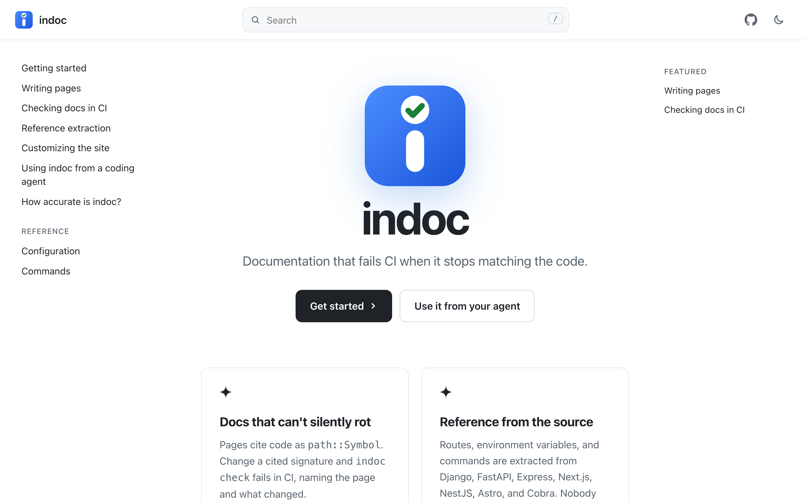
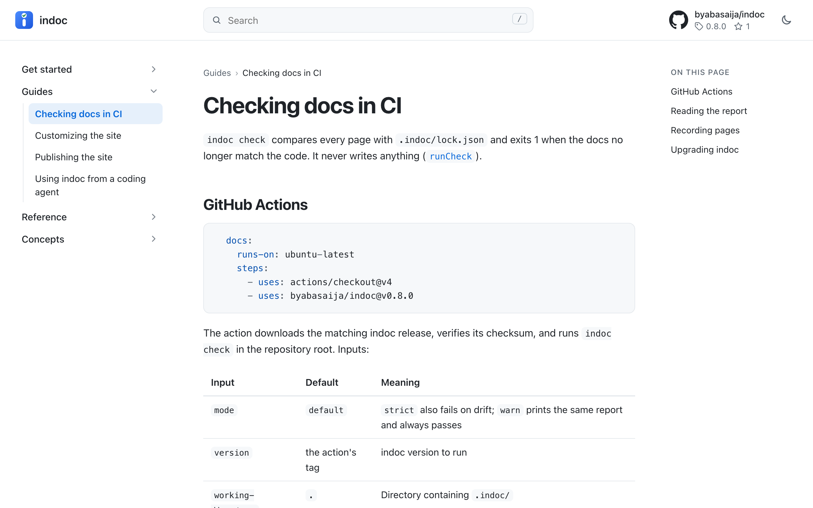

<p align="center">
  
</p>

<h1 align="center">indoc</h1>

<p align="center">
  <strong>Documentation that fails CI when it stops matching the code.</strong>
</p>

<p align="center">
  <a href="https://github.com/byabasaija/indoc/actions/workflows/ci.yml"></a>
  <a href="https://github.com/byabasaija/indoc/releases"></a>
  <a href="LICENSE"></a>
  <a href="go.mod"></a>
</p>

<p align="center">
  <a href="#quick-start">Quick start</a> ·
  <a href="#how-it-works">How it works</a> ·
  <a href="#indoc-vs-docusaurus-and-mkdocs">Compared to Docusaurus</a> ·
  <a href="documentation/getting-started.md">Docs</a> ·
  <a href="documentation/accuracy.md">Accuracy</a> ·
  <a href="ROADMAP.md">Roadmap</a>
</p>

<p align="center">
  <picture>
    <source media="(prefers-color-scheme: dark)" srcset="design/screenshots/landing-dark.png">
    
  </picture>
</p>

---

Docs rot quietly. A function gets a new parameter, a route moves, and the guide that explains them keeps saying the old thing until a user hits it.

**indoc ties every Markdown page to the code it describes.** When that code changes and the page does not, your pull request goes red:

```console
$ indoc check
documentation/dev/checkout.md
  ✗ STALE      shop/checkout/service.py::CheckoutService.charge  cited symbol's signature changed
    DRIFT      shop/checkout/session.py  implementation changed; signatures unchanged

6 pages checked: 1 stale, 1 drift
Error: docs do not match the code
```

Your coding agent writes the pages. indoc checks them. indoc never calls an AI model and needs no API key.

## Why indoc

- 🔴 **Stale docs fail CI.** Pages cite code as `path::Symbol`. Change a cited signature and `indoc check` names the page and what changed. Comments, formatting, and logging changes are ignored, so it doesn't cry wolf.
- 🔗 **Citations are verified.** Rename a function and the page citing it is reported as broken; the site won't build until it's fixed. In the built site every citation links to the exact line.
- 🧭 **Reference from the source.** Routes, environment variables, and CLI commands are extracted from Django, FastAPI, Express, Next.js, NestJS, Astro, and Cobra. Nobody copies them by hand.
- 🤖 **Made for coding agents.** Install the plugin for Claude Code or Copilot CLI and say "document this project". It agrees on readers and an outline with you, writes, checks, and builds.
- 📦 **One binary, one static site.** No Node, no Python, no config sprawl. The output is plain HTML with search, dark mode, and highlighting that works on any host or straight from disk.

## Quick start

### With your coding agent

**Claude Code**

```
/plugin marketplace add byabasaija/indoc
/plugin install indoc@indoc
```

**GitHub Copilot CLI**

```
copilot plugin install byabasaija/indoc:plugin
```

Then ask: *"document this project"*. Later: *"update the stale docs"*.

The plugin downloads the indoc binary for your platform on first use and verifies its checksum. Nothing else to install. Other MCP clients can run `indoc mcp` directly.

### In CI

```yaml
jobs:
  docs:
    runs-on: ubuntu-latest
    steps:
      - uses: actions/checkout@v4
      - uses: byabasaija/indoc@v0.3.0
        # with:
        #   mode: warn   # report without failing while you try it out
```

### By hand

Download a binary from [Releases](https://github.com/byabasaija/indoc/releases), or:

```sh
go install github.com/byabasaija/indoc/cmd/indoc@latest
```

```sh
indoc init       # create .indoc/config.yaml
indoc preview    # live site on localhost while you write
indoc bundle     # build the site, record pages as verified
indoc check      # in CI: fail when docs no longer match the code
```

## How it works

A page says which code it covers and cites the symbols it explains:

```markdown
---
title: How checkout charges a card
sources:
  - shop/checkout/**
---

Every order is charged by `shop/checkout/service.py::CheckoutService.charge`,
which picks a payment provider for the customer's country.
```

`.indoc/lock.json` (committed) records what each page was verified against. `indoc check` compares the code with that record:

| What changed | Result |
|---|---|
| A cited symbol's signature, or the symbol is gone | **stale** / **broken**: check fails |
| A public signature added, removed, or changed under `sources` | **stale**: check fails |
| A cited symbol's body | **drift**: reported; fails on `strict: true` pages or with `--strict` |
| Private helpers, tests, or implementation under `sources` | **drift**: reported; fails with `--strict` |
| Comments, docstrings, logging calls, formatting | ignored |

Fix the page, or run `indoc ack <page>` to confirm it is still correct. Either way, the review is recorded in git.

These rules were tuned by replaying 100 commits of a real production codebase: 85% of sampled flags were real problems, and about 3–4% of commits would have failed CI with nothing wrong in the docs. [How it was measured](documentation/accuracy.md).

## What you get

**A docs site.** One pre-rendered HTML page per Markdown file, readable without JavaScript.

<picture>
  <source media="(prefers-color-scheme: dark)" srcset="design/screenshots/site-dark.png">
  
</picture>

- Sidebar from your folders, full-text search, light and dark themes
- Syntax highlighting and copy buttons on code blocks, Mermaid diagrams
- A landing page with hero and feature cards, set in frontmatter
- "Edit this page", "Last updated", GitHub stars, header links, footer
- Your logo and colors, plus `custom.css` and `head.html` when you need more
- Relative links: serve it from any host or path, or mount it in your app

See [Customizing the site](documentation/site.md).

**Reference pages, extracted.** Routes with HTTP methods and handlers, environment variables with defaults (secrets redacted), and CLI commands with flags, each linking to its source line.

**A project map for your agent.** `indoc scan --json` reports frameworks, entry points, real task-runner commands, unpublished Markdown, and the most-changed files, so the agent writes about what your project actually does instead of a generic outline.

**Nothing published by accident.** New pages go in `documentation/`. Plans, reviews, and agent notes in `docs/` are never published unless you name them.

## indoc vs Docusaurus and MkDocs

Docusaurus and MkDocs are excellent site generators. indoc is narrower: it keeps docs correct.

| | indoc | Docusaurus | MkDocs |
|---|---|---|---|
| CI fails when code described by a page changes | ✅ | ❌ | ❌ |
| Code references verified to exist | ✅ any supported language | ❌ | Python API docs, via mkdocstrings |
| Routes, env vars, commands from source | ✅ | From an OpenAPI spec, via plugin | Via plugins |
| Written by your coding agent, checked by the tool | ✅ plugin + MCP | ❌ | ❌ |
| Toolchain | One binary | Node.js, React | Python |
| Versioned docs, i18n, plugins, MDX | ❌ by design | ✅ | ✅ |

**Already on Docusaurus or MkDocs? Keep it.** Add `sources:` and citations to your existing pages and run `indoc check` in CI. indoc reads Docusaurus frontmatter, and building the site with indoc is optional.

## Support

<details>
<summary><strong>Languages</strong>: JavaScript, TypeScript, Python, Go</summary>

<br>

Precise staleness and `path::Symbol` citations need a parser. Everything else works on any repository.

| Language | Parser | Checked against |
|---|---|---|
| JavaScript, TypeScript, JSX, TSX | tree-sitter | The TypeScript compiler: 9,436 files, 56,396 symbols, all matching |
| Python | tree-sitter | CPython's own parser: 34,120 of 34,121 files, 454,837 symbols |
| Go | Go standard library | — |
| Others | — | Files are tracked; any change is reported as drift |

Exported JavaScript/TypeScript declarations are public; Python uses `_name` and Go lowercase names for private. Adding a private helper never fails `check`.

</details>

<details>
<summary><strong>Frameworks</strong>: Django, DRF, FastAPI, Express, Next.js, NestJS, Astro, Cobra</summary>

<br>

| Framework | Routes | Configuration | Commands |
|---|---|---|---|
| Django + DRF | ✅ URLconf through `include()`, routers, `@action`; methods from views, viewsets, `@api_view` | ✅ django-environ, python-decouple, `os.environ` | ✅ management commands |
| FastAPI | ✅ decorators, `APIRouter` prefixes, nested `include_router`, websockets, mounts | ✅ pydantic `BaseSettings` | |
| Express | ✅ routes across files, `route()` chains, mounted routers and sub-apps | `process.env` | |
| Next.js | ✅ App Router pages and route handlers, Pages Router pages and API routes | `process.env` | |
| NestJS | ✅ `@Controller` + `@Get`/`@Post`/..., global prefix | `process.env` | |
| Astro | ✅ `src/pages` pages and endpoints | `import.meta.env` | |
| Cobra (Go) | | `os.Getenv` | ✅ command tree, flags, arguments |
| Flask, Go `net/http` | best effort | | |
| Rails, Laravel | planned | | |

Every extractor is tested against the framework's own route table: Django's URL resolver on six real projects (524 routes), FastAPI's router, Express 4 and 5 at runtime, `next build`'s route manifests, the routes Nest registers, and Cobra's command tree. All match route for route, including HTTP methods. Extraction is static: indoc never imports or runs your code.

`indoc scan` also warns about routes that can never be reached and variables missing from `.env.example`.

</details>

## FAQ

**Does indoc use AI?**
No. Your coding agent (or you) writes the pages. indoc parses code, records hashes, and builds HTML. It makes no network calls during a build.

**Will it publish my internal notes?**
No. Only files matched by `pages:` in `.indoc/config.yaml` are published. Pages default to `documentation/`, not `docs/`, because `docs/` is where plans and agent notes usually collect.

**Won't it fail CI on every commit?**
No. Only public signatures and cited symbols fail the check. Body changes are reported as drift and fail only where you ask for it (`strict: true` or `--strict`). Start with `mode: warn` if you want to see it first.

**My language isn't supported.**
indoc still tracks the files a page covers and reports any change as drift. Citations need a parser; open an issue with a real repository you'd like supported.

**Where does the site go?**
`.indoc/site/` by default, gitignored. Point `output_dir` at a folder your app or static host serves.

## Contributing

Issues and pull requests are welcome. Framework and language requests are most useful with a link to a real repository that uses them.

```sh
go test ./...                              # all tests
go run ./cmd/indoc check --strict          # indoc's own docs must match its code
make grammars                              # rebuild tree-sitter grammars (Docker)
make vendor                                # refresh Prism and Mermaid
```

[ARCHITECTURE.md](ARCHITECTURE.md) explains how the pieces fit and why, [RELEASING.md](RELEASING.md) how to cut a release, [documentation/accuracy.md](documentation/accuracy.md) how each part is tested against the real tools, and [ROADMAP.md](ROADMAP.md) what's next and what indoc won't do.

## License

[MIT](LICENSE)
