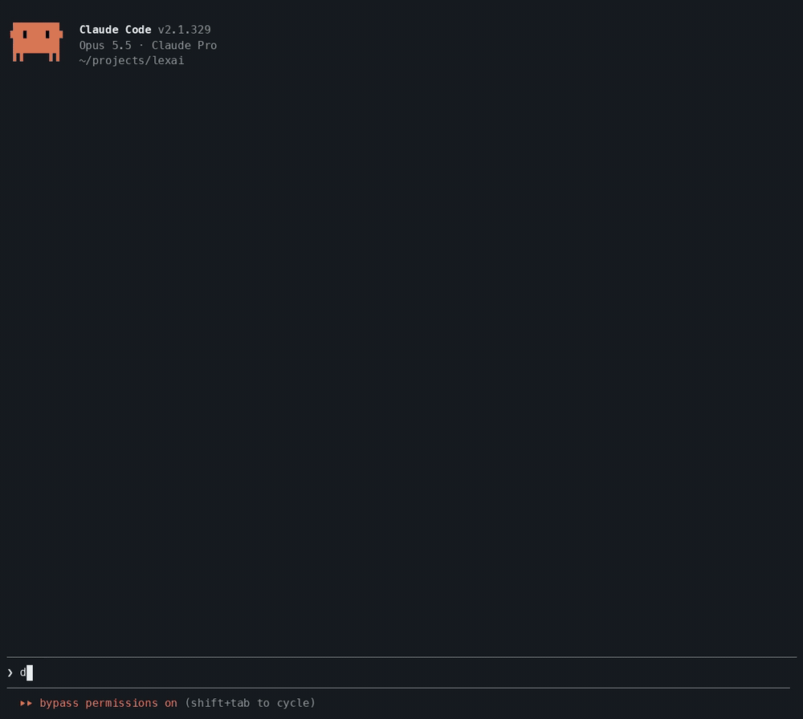

<p align="center">
  
</p>

<h1 align="center">indoc</h1>

<p align="center">
  <strong>Documentation that fails CI when it stops matching the code.</strong>
</p>

<p align="center">
  <a href="https://github.com/byabasaija/indoc/actions/workflows/ci.yml"></a>
  <a href="https://github.com/byabasaija/indoc/releases"></a>
  <a href="LICENSE"></a>
</p>

<p align="center">
  <a href="https://byabasaija.github.io/indoc/"><strong>Documentation</strong></a> ·
  <a href="#quick-start">Quick start</a> ·
  <a href="#how-it-works">How it works</a> ·
  <a href="#indoc-vs-docusaurus-and-mkdocs">vs Docusaurus</a> ·
  <a href="ROADMAP.md">Roadmap</a>
</p>

<p align="center">
  
</p>

Docs rot quietly. A function gets a new parameter, a route moves, and the guide that explains them keeps saying the old thing until a user hits it.

**indoc ties every Markdown page to the code it describes.** Your coding agent writes the pages and cites the functions they explain. When that code changes and a page doesn't, `indoc check` fails your pull request and names the page. indoc itself never calls an AI model.

- **Stale docs fail CI.** Comments, formatting, and private helpers are ignored, so it doesn't cry wolf.
- **Reference from the source.** Routes, environment variables, and CLI commands are extracted from Django, FastAPI, Express, Next.js, NestJS, Astro, and Cobra.
- **A real docs site.** Sections, search, dark mode, your logo; one static folder that works on any host, or served by your own app.
- **One binary.** No Node, no Python, no API key.

## Quick start

**With your coding agent.** In Claude Code:

```
/plugin marketplace add byabasaija/indoc
/plugin install indoc@indoc
```

or in GitHub Copilot CLI: `copilot plugin install byabasaija/indoc:plugin`. Then ask *"document this project"*, and later *"update the stale docs"*. The plugin downloads and verifies the indoc binary itself.

**In CI**, add one step to a workflow:

```yaml
      - uses: byabasaija/indoc@v0.8.2
```

**By hand** on macOS or Linux (or `go install github.com/byabasaija/indoc/cmd/indoc@latest`, or a binary from [Releases](https://github.com/byabasaija/indoc/releases)):

```sh
curl -fsSL https://github.com/byabasaija/indoc/releases/latest/download/install.sh | sh
indoc init && indoc preview
```

[Getting started](https://byabasaija.github.io/indoc/get-started/quick-start/) has the rest.

## How it works

A page lists the code it covers and cites the symbols it explains:

```markdown
---
title: How checkout charges a card
sources:
  - shop/checkout/**
---

Every order is charged once per idempotency key (`shop/checkout/service.py::CheckoutService.charge`).
```

`indoc bundle` builds the site and records what each page was checked against in `.indoc/lock.json`. `indoc check` compares the code with that record:

<p align="center">
  
</p>

| What changed | Result |
|---|---|
| A cited signature, or a public signature under `sources` | **stale**: check fails |
| A cited symbol was renamed or removed | **broken**: check fails |
| A cited symbol's body, or private code under `sources` | **drift**: reported; fails only with `--strict` or on `strict: true` pages |
| Comments, docstrings, logging, formatting | ignored |

Fix the page, or run `indoc ack <page>` if it is still correct. Replaying 100 commits of a production codebase, 85% of the flags were real problems and 3–4% of commits would have failed with nothing wrong ([how it was measured](documentation/concepts/accuracy.md)).

## Built with indoc

indoc's own documentation is Markdown in [`documentation/`](documentation/), citing indoc's code. CI checks it on every pull request, and indoc builds and publishes it to [byabasaija.github.io/indoc](https://byabasaija.github.io/indoc/).

## indoc vs Docusaurus and MkDocs

Docusaurus and MkDocs are excellent site generators. indoc is narrower: it keeps docs correct.

| | indoc | Docusaurus | MkDocs |
|---|---|---|---|
| CI fails when the code a page describes changes | ✓ | | |
| Code references verified to exist | ✓ | | Python API docs, via mkdocstrings |
| Routes, env vars, commands from source | ✓ | From an OpenAPI spec, via plugin | Via plugins |
| Written by your coding agent, checked by the tool | ✓ | | |
| Toolchain | One binary | Node.js, React | Python |
| Versioned docs, i18n, plugins, MDX | No, by design | ✓ | ✓ |

**Already on Docusaurus or MkDocs? Keep it.** Add `sources:` and citations to your pages and run `indoc check` in CI; building the site with indoc is optional.

## Learn more

- [Documentation](https://byabasaija.github.io/indoc/): writing pages, CI, customizing and publishing the site
- [Supported languages and frameworks](documentation/reference/support.md) and [FAQ](documentation/concepts/faq.md)
- [How accurate is indoc?](documentation/concepts/accuracy.md): every parser and extractor tested against the real tools
- [Roadmap](ROADMAP.md): what's next, and what indoc won't become
- [Contributing](CONTRIBUTING.md) and [Discussions](https://github.com/byabasaija/indoc/discussions)

## License

[MIT](LICENSE)
